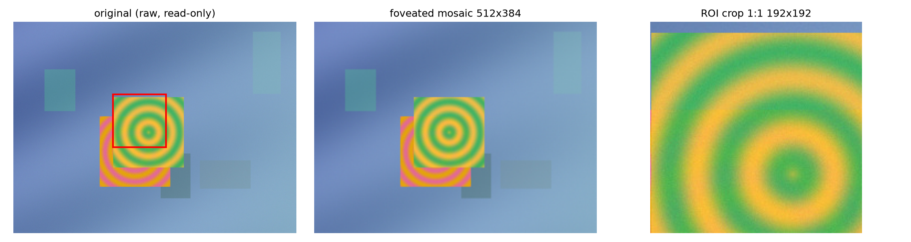
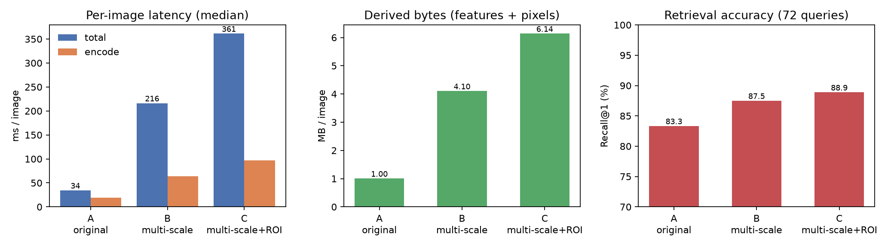
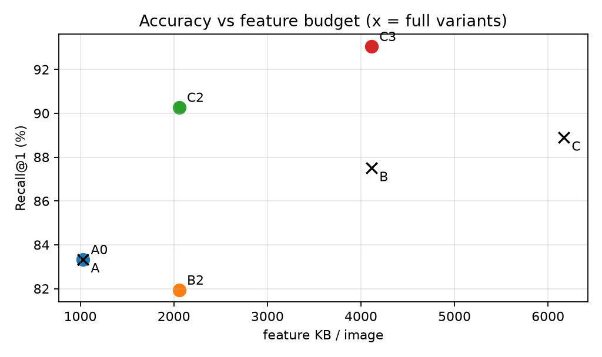

# ALAC-V Phase 1 交付报告

**阶段**：Phase 0（环境审计）+ Phase 1（静态图像视觉编码）
**执行**：主工程 Agent（lead）
**日期**：2026-11-14
**状态**：**已完成，等待 Owner 审核。未进入 Phase 2。**

---

## 摘要

本阶段在单机（RTX 5070 12 GB / 32 GB RAM / Windows）上建立了 ALAC-V 的**可靠、可复现的视觉数据处理基础**：

1. 环境审计通过：CUDA 13.0 运行时在 sm_120 上可用，FP16 矩阵乘 54.3 TFLOPS（FP32 的 2.8×），DINOv2 ViT-S/14 单次 FP16 前向 **5.23 ms**。
2. 实现了完整的静态图像管线：**只读归档 → 四档金字塔 → Foveated ROI → DINOv2 CLS+Patch（FP16）→ SQLite+SafeTensors 知识库 → 检索与高清回溯**。
3. 在 98 张图（24 张合成基准 + 72 条查询 + 2 张真实图）、3 组变体 × 3 次重复的对照实验中：
   - 单图端到端 **34.4 / 216.2 / 361.3 ms**（A/B/C，中位数）；
   - 派生存储 **1.00 / 4.10 / 6.14 MB**（每图）；
   - 检索 Recall@1 **0.833 / 0.875 / 0.889**，mAP@10 **0.883 / 0.918 / 0.922**；
   - 局部回溯 PSNR **26.76 / 29.19 / 29.10 dB**。
4. 关键诚实结论：**没有一组能同时做到"省 30% 存储且准确率损失 ≤5 pp"**，因此本阶段**不宣称任何效率提升**。但消融显示 **foveated+ROI 描述子的信息密度最高**：同为 2.01 MB 时比金字塔高 +8.4 pp，同为 4.02 MB 时高 +5.6 pp。
5. 最薄弱环节：**ROI 选择的语义命中率仅 58.3%**（梯度能量法），这是下一阶段最值得投入的方向之一。

**核心原则遵守情况**：原始数据不可变（98/98 校验通过）、未训练主干、无外部 LLM 调用、无图像上传、无大数据集下载、独立 venv。

---

## 0. 交付清单（对应任务单第八节）

| # | 交付物 | 位置 | 状态 |
|---|---|---|---|
| 1 | 硬件与环境审计报告 | [`docs/02_audit/environment-audit.md`](../02_audit/environment-audit.md) + JSON 证据 | ✅ |
| 2 | 项目目录结构 | 本报告 §2 + `README.md` | ✅ |
| 3 | 模型下载与运行说明 | 本报告 §3 + [`docs/06_ops/runbook.md`](../06_ops/runbook.md) | ✅ |
| 4 | 静态图像编码程序 | `src/alacv/`、`scripts/`、CLI | ✅ |
| 5 | 多尺度与 Foveated ROI 实现 | 本报告 §5 + `src/alacv/{imaging,foveation}.py` | ✅ |
| 6 | 三组实验对比结果 | 本报告 §6 + [`EXP-0001`](../04_experiments/EXP-0001-abc-comparison.md) | ✅ |
| 7 | GPU 显存与运行性能报告 | 本报告 §7 | ✅ |
| 8 | 已知问题和下一阶段建议 | 本报告 §8 | ✅ |
| — | 单元测试 | `tests/`，**56 项全部通过** | ✅ |
| — | 模型许可信息 | [`docs/02_audit/model-licenses.md`](../02_audit/model-licenses.md) + `artifacts/models/dinov2_vits14/LICENSE` | ✅ |

---

## 1. 硬件与环境审计（摘要）

完整报告见 [`environment-audit.md`](../02_audit/environment-audit.md)，原始数据见 `artifacts/runs/20261114T105248Z_AUDIT/`。

| 项 | 实测值 |
|---|---|
| 操作系统 | Windows 10 Pro 26H2，build 26300.9711，x64 |
| CPU | Intel Core Ultra 7 265K，20 核 / 20 线程（Arrow Lake 无超线程），3.9 GHz |
| RAM | 31.48 GB（审计时可用 10.9 GB，桌面已占约 20 GB） |
| GPU | NVIDIA GeForce RTX 5070，**12227 MiB**，CC 12.0 (sm_120)，PCIe 4.0 ×16，250 W |
| 驱动 / CUDA | 驱动 616.92（UMD 13.4）；toolkit 12.8.93；PyTorch cu130 运行时 13.0；cuDNN 92400 |
| 显示占用 | 2.6–2.8 GB → 模型实际可用约 9.2–9.4 GB |
| 磁盘 | C: 247 GB 可用；D: 987 GB 可用 |
| Python | CPython 3.11.9，独立 `.venv`（系统 Python 未改动） |
| PyTorch | 2.14.1+cu130，`cuda.is_available()=True`，`arch_list` 含 sm_120 |

**混合精度验证**：1024×1024 FP16 矩阵乘，最大绝对误差 0.070、相对误差 2.1e-3、无 NaN/Inf；2048×2048 FP16 **54.3 TFLOPS** vs FP32 19.1 TFLOPS；DINOv2 FP16 前向 5.23 ms、激活 61.1 MB。

**结论**：任务单要求"确认 RTX 5070 的 CUDA 推理和混合精度运行正常"——**确认通过**。

---

## 2. 项目目录结构

```
D:\ALAC_V\
├── README.md / CHANGELOG.md / pyproject.toml
├── requirements.txt / requirements.lock.txt     # 顶层依赖 + 全量锁文件
├── .venv/                                       # 隔离环境（不入库）
├── configs/
│   ├── default.yaml                             # 基线配置（所有参数）
│   ├── experiment_abc.yaml                      # EXP-0001 覆盖 + 消融定义
│   └── dataset_ds0001.yaml                      # 数据集生成参数
├── src/alacv/
│   ├── config.py        # 加载/校验/哈希/快照
│   ├── logging_utils.py # JSONL 结构化日志
│   ├── ingest.py        # 只读、内容寻址归档
│   ├── imaging.py       # 解码、色彩归一、金字塔
│   ├── foveation.py     # ROI 选择 + 分级合成
│   ├── features.py      # DINOv2 封装（CLS+Patch, FP16）
│   ├── store.py         # SQLite + SafeTensors
│   ├── retrieval.py     # 余弦检索、回溯、指标
│   ├── metrics.py       # 计时/显存/CPU/RAM/PSNR/SSIM
│   ├── pipeline.py      # 变体 A/B/C 编排
│   └── cli.py           # ingest / query / backtrack / stats / verify
├── scripts/
│   ├── audit_environment.py     # Phase 0 审计
│   ├── fetch_model.py           # 权重 + 许可证 + 指纹（可续传）
│   ├── make_dataset.py          # DS-0001 程序化生成
│   ├── run_experiments.py       # A/B/C 对照实验
│   ├── eval_ablations.py        # 描述子消融（复用特征）
│   ├── bootstrap_ci.py          # 配对 bootstrap CI
│   ├── make_figures.py          # 报告插图
│   └── verify_raw_integrity.py  # 归档不可变性校验
├── tests/                       # 56 项单元测试
├── docs/                        # 文档系统（见 docs/README.md）
├── data/
│   ├── raw/<aa>/<sha256>.<ext>  # 只读归档（内容寻址）
│   ├── processed/<id>/pyramid|foveated|roi/
│   ├── features/<id>/<source>.safetensors
│   ├── index/alacv.sqlite
│   ├── datasets/ds-0001/{base,query,real}
│   └── manifests/{ds-0001..., model-dinov2_vits14}.json
└── artifacts/
    ├── runs/<run_id>/           # 每次运行：配置快照 + 日志 + 指标 + 逐图明细 + store
    ├── models/dinov2_vits14/    # 权重 + LICENSE + SHA256SUMS
    ├── experiments/             # 汇总表、消融、CI
    └── figures/                 # 报告插图
```

**设计意图**：`data/` 是"知识库"，`artifacts/runs/` 是"证据"。任何报告数字都能在某个 run 目录里找到 `config.snapshot.yaml` + `config.sha256` + `metrics.json` + `items.jsonl`。

---

## 3. 模型下载与运行说明

### 3.1 模型

| 项 | 值 |
|---|---|
| 模型 | DINOv2 ViT-S/14（`facebook/dinov2-small`） |
| 来源 | HuggingFace，revision `ed25f3a31f01632728cabb09d1542f84ab7b0056` |
| 参数 / 权重 | 22.06 M / 42.1 MB（FP16） |
| 许可证 | Apache-2.0（全文已保存 `artifacts/models/dinov2_vits14/LICENSE`） |
| 权重 SHA-256 | `ae1e99fcefd534ed978cdeb8326f08030c96e28b7a81ffcbc98a857c84d14be1` |
| 是否微调 | 否（全程 eval + inference_mode） |

### 3.2 下载

```powershell
cd D:\ALAC_V
$env:HTTPS_PROXY='http://127.0.0.1:7897'; $env:HTTP_PROXY=$env:HTTPS_PROXY
$env:HF_HOME='D:\ALAC_V\.hf-cache'      # 用户目录缓存不可写
.\.venv\Scripts\python.exe scripts\fetch_model.py
```

脚本对每个文件实现 **Range 续传 + 12 次重试**（本机代理长连接不稳定，首次下载在 37/88 MB 处断流）。产物：
- `artifacts/models/dinov2_vits14/{model.safetensors, config.json, LICENSE, SHA256SUMS}`
- `data/manifests/model-dinov2_vits14.json`（revision / SHA-256 / 许可证 / 预处理参数来源）

### 3.3 运行

```powershell
# 单图入库（归档+金字塔+foveation+特征+索引）
python -m alacv.cli ingest --input <dir> --variant C

# 以图搜图
python -m alacv.cli query --image <file> --variant C --topk 5

# 按 image_id + ROI 回溯高清局部
python -m alacv.cli backtrack --image-id <id> --roi 0 --out out.png

# 完整性校验 / 统计
python -m alacv.cli verify
python -m alacv.cli stats
```

模型加载**只读本地目录**（`local_files_only=True`），无运行时网络依赖；离线可用。

---

## 4. 静态图像编码程序

### 4.1 数据流

```
原始文件 → ① 解码校验 → SHA-256 → 只读归档（内容寻址）
        → ② 四档金字塔（WebP q95）
        → ③ ROI 选择 → foveated 马赛克（1/2 画布）+ 全分辨率 ROI 裁片
        → ④ 各源 518×518 → DINOv2 → CLS(384) + Patch(37×37×384)，FP16
        → ⑤ SQLite 元信息 + SafeTensors 特征
        → ⑥ 余弦检索 → Top-K → ROI 坐标 → 原图回溯
```

### 4.2 原始图像归档（P1-1/P1-2）

- 格式：**JPEG / PNG / WebP / AVIF 全部实测可用**（Pillow 13.0.0 内置 libavif）。
- 身份 = 文件字节 SHA-256；归档路径 `data/raw/<sha[:2]>/<sha>.<ext>`，同内容不同名只存一份。
- 归档后设只读属性；代码层**没有任何覆盖/删除原始文件的接口**。
- 元数据入库：宽高、通道、PIL mode、颜色空间（ICC 描述解析：sRGB / Display P3 / Adobe RGB / Gray）、ICC SHA-256、文件大小、EXIF 存在性（不保存原值，保护隐私）。
- 解码失败/不支持格式 → 记 `status=rejected` + 原因，不中断批处理。

### 4.3 视觉知识库（P1-7）

SQLite 7 张表：`models / images / assets / features / rois / runs / run_items`；WAL + 外键 + 显式事务。

| 任务单要求 | 存储位置 |
|---|---|
| 原始图片索引 | `images`（sha256、rel_path、尺寸、颜色空间、大小） |
| 多尺度图像 | `assets(kind=pyramid, level=0..3)` + WebP 文件 |
| 全局视觉特征 | `features(source=original/pyramid:L*/foveated/roi:*)` 的 `cls` |
| 局部 Patch 特征 | 同文件 `patch`（1369×384, FP16） |
| ROI 坐标 | `rois(x,y,w,h,score,method)` |
| 模型版本 | `models`（revision、权重 SHA-256、许可证、预处理参数） |
| 数据处理元信息 | `assets/features.config_sha256`、`runs`、SafeTensors 内嵌 `meta_json` |

单特征文件 **1,052,874 字节**（1.00 MB），字段自描述，脱离数据库可自证来源。

### 4.4 可复现性

- 配置：`default.yaml` + 实验覆盖，`config.snapshot.yaml` + `config.sha256` 随 run 保存。
- 内容哈希 `stable_sha256` 剔除路径/实验等易变项，用于判断派生数据是否过期。
- 每次 run 记录 `env.json`（Python/torch/CUDA/GPU/驱动）与 `model.json`（模型指纹）。
- 幂等：同一图重复入库返回同一 `image_id`，不重复计算（`UNIQUE(image_id, source, config_sha256)`）。

---

## 5. 多尺度与 Foveated ROI 实现

### 5.1 多尺度（P1-3）

- 四档：1/1、1/2、1/4、1/8，bicubic + antialias，WebP q95。
- 每级独立缩放到 518×518（短边缩放 + 中心裁剪）后前向，patch 网格统一为 37×37，跨尺度可对齐。
- **不把"1/8 放大回 518"说成超分辨率**：它编码的是低频/全局结构。

### 5.2 Foveated ROI（P1-4）



- **ROI 选择**：灰度 → 高斯模糊 → Sobel 梯度幅值 → 积分图滑窗能量 → 取最大 → NMS 得 ≤2 个 ROI；纯色图退化为中心。支持 `manual` 坐标覆盖。
- **双产物**：
  1. `foveated.webp`：画布 = 原图 1/2。周边 = 原图 1/4 上采样；旁中央环 = 原图 1/2；中央凹 = ROI 区 1/2；边界 8 px 羽化。
  2. `roi_XX.webp`：ROI 在**原图像素坐标**上的 1:1 裁片（WebP q96），用于真正的高清回溯。
- **不丢失焦点外信息**：原始文件始终只读保存；周边低清是"表示"，不是"删除"；`data/raw` 提供无限期重放能力。

### 5.3 编码器（P1-5/P1-6）

- 预处理：短边→518、中心裁剪、RGB、/255、ImageNet mean/std；全部写入 `model.json`。
- 提取 `last_hidden_state[:, 0]`（CLS）与 `[:, 1:]`（1369 patch），转 FP16 落盘。
- 变体：A = 单源；B = 4 级；C = 4 级 + foveated + ROI（6 源），描述子为各源 CLS 的 L2 归一化拼接再归一化。

---

## 6. 三组实验对比结果（P1-8）

**数据**：DS-0001，24 张 1024×768 合成基准 + 72 条扰动查询（亮度/对比度/旋转/缩放/JPEG 重压缩）+ 2 张本机真实图；**纯程序化生成，无外部下载**。
**协议**：3 变体 × 3 重复，每 run 独立 store，处理顺序随机化；报中位数。
**预注册**：假设、指标、判定阈值在运行前写定（[`EXP-0001`](../04_experiments/EXP-0001-abc-comparison.md) §3–§6）。

### 6.1 主结果

| 变体 | 维度 | 总时间 中位/P95 (ms) | 编码 (ms) | 显存峰值 (MB) | 特征/图 | 合计/图 | Recall@1 | Recall@5 | mAP@10 | 回溯 PSNR | 回溯 SSIM |
|---|---|---|---|---|---|---|---|---|---|---|---|
| A | 384 | 34.4 / 40.3 | 19.6 | 91.1 | 1.00 MB | 1.00 MB | 0.833 | 0.944 | 0.883 | 26.76 | 0.869 |
| B | 1536 | 216.2 / 258.9 | 63.8 | 91.1 | 4.02 MB | 4.10 MB | 0.875 | 0.986 | 0.918 | 29.19 | 0.852 |
| C | 2304 | 361.3 / 412.0 | 97.4 | 91.1 | 6.02 MB | 6.14 MB | 0.889 | 0.972 | 0.922 | 29.10 | 0.851 |



### 6.2 判定（严格按预注册规则）

| 假设 | 观测 | 判定 |
|---|---|---|
| H1 多尺度优于单尺度 | +4.2 pp，配对 bootstrap 95% CI **[0.0, +9.7] pp** | **未达标准**（方向支持但 CI 触 0） |
| H2 C 不劣于 B | +1.4 pp，CI [−5.6, +8.3] | **支持** |
| H3 C 回溯优于 A | +2.34 dB | **支持**（与 B 的 +2.43 dB 几乎相同） |
| H4 C 比 B 省存储 | 1.50×（更大） | **拒绝** |
| H5 效率提升无能力损失 | 无满足项 | **不允许宣称效率提升** |

### 6.3 消融：foveation 才是信息密度更高的那一半

| 描述子 | 源 | 维度 | 特征/图 | Recall@1 | mAP@10 |
|---|---|---|---|---|---|
| A0 | L0 | 384 | 1.00 MB | 0.833 | 0.883 |
| B2 | L0+L2 | 768 | 2.01 MB | 0.819 | 0.886 |
| **C2** | foveated + ROI | 768 | **2.01 MB** | **0.903** | 0.927 |
| B | L0–L3 | 1536 | 4.02 MB | 0.875 | 0.918 |
| **C3** | L2+L3+foveated+ROI | 1536 | 4.02 MB | **0.931** | 0.953 |
| C | 6 源 | 2304 | 6.02 MB | 0.889 | 0.922 |



三点解读：

1. **同预算下 foveated 描述子更准**：C2 vs B2 = +8.4 pp；C3 vs B = +5.6 pp。
2. **级数不是越多越好**：B2 < A0，C < C3。低频级会稀释描述子。
3. **C 的"6 源"定义本身是浪费**；下一阶段应以 **C3（4 源，4.02 MB，0.931）** 作为默认配置候选，而不是 C。

### 6.4 视觉相似性

同源对 vs 异源对余弦分布 AUC：A 0.891 / B 0.899 / **C 0.918**。三组都能把"同一场景"与"不同场景"分开，C 的分离度最高。

### 6.5 局部高清回溯

以选中 ROI 框为基准，比较"从该变体派生表示还原的裁剪"与原图裁剪：

- A 26.76 dB / 0.869（等效 518 采样，细节丢失）
- B 29.19 dB / 0.852（L0 WebP q95）
- C 29.10 dB / 0.851（ROI 裁片 WebP q96）

**口径声明**：原始归档对三组都永久保留，所以"系统级回溯"三组都能做到无损；该指标衡量的是**不触碰原始层时，派生表示保留了多少高清细节**。B 与 C 在该口径下等价（+2.4 dB vs A），说明"全分辨率 ROI 裁片"与"保留 L0"在像素代价上相当，但 C 少存了 3 个尺度。

---

## 7. GPU 显存与运行性能报告（P1-9/P1-10）

### 7.1 显存

| 指标 | 值 | 说明 |
|---|---|---|
| 模型权重（FP16） | 42.1 MB | 22.06 M 参数 |
| 进程峰值 `max_memory_allocated` | **91.1 MB** | 三变体相同（含 CUDA context/allocator） |
| 单图激活峰值 | **16.0 MB**（增量） | 单次 518 前向 |
| 审计单次前向激活 | 61.1 MB | 含输入缓冲与 workspace |
| 桌面占用 | 2.6–2.8 GB | 必须从 12 GB 中扣除 |

**关键结论**：batch=1 时，**变体不改变显存峰值，只改变时间**（源数线性增加前向次数）。12 GB 卡对 ViT-S/14 @ 518 有 **>100× 余量**；Phase 2 若要 batch>1 或更大输入，需重测。

### 7.2 延迟（每图，中位数）

| 阶段 | A | B | C |
|---|---|---|---|
| 归档（解码+SHA-256+拷贝+入库） | 6.1 | 6.1 | 6.1 |
| 金字塔（4 级 + WebP q95） | — | 102.4 | 100.8 |
| Foveation（ROI+马赛克+裁片） | — | — | 99.2 |
| DINOv2 编码 | 19.6 | 63.8 | 97.4 |
| 特征落盘 + DB | ~7 | 30.8 | 44.4 |
| **合计** | **34.4** | **216.2** | **361.3** |

- 单次前向约 **16 ms**（含预处理/后处理），与审计的 5.23 ms 纯前向一致（其余为缩放/拷贝/同步）。
- **B/C 的主要成本是金字塔 WebP 编码（~102 ms），不是模型**。这是明确的优化点（见 §8）。
- 吞吐：A 29 图/s、B 4.6 图/s、C 2.8 图/s（98 图 wall clock）。

### 7.3 检索与 CPU/RAM

| 指标 | A | B | C |
|---|---|---|---|
| 索引构建（24 张库） | 34.6 ms | 132.0 ms | 211.8 ms |
| 单查询（含描述子读取+余弦） | 1.49 ms | 5.97 ms | 9.54 ms |
| 平均 CPU 占用 | 15.5 核 | 14.7 核 | 10.8 核 |
| RSS 峰值 | 1.33 GB | 1.38 GB | 1.51 GB |

CPU 占用高是因为 Pillow 的 WebP 编码与 numpy 操作走多线程；GPU 侧并不饱和（单图 batch 无法喂满 5070）。

---

## 8. 已知问题与下一阶段建议

### 8.1 已知问题（按影响排序）

| # | 问题 | 证据 | 影响 | 建议处置 |
|---|---|---|---|---|
| I-01 | **ROI 语义命中率仅 58.3%** | EXP-0001 §8.4 | C 的"焦点"常落在纹理强但非目标的区域 | Phase 2 研究学习式重要性（如 patch 范数/自注意力），或用少量标注校准 |
| I-02 | 只在合成数据上测准确率 | DS-0001 由脚本生成 | 准确率不能外推自然图像 | 需要 Owner 批准小规模公开自然图像集（如 200 张），并补人工/弱标签 |
| I-03 | 样本量小（72 查询） | CI 宽达 ±5–8 pp | H1 无法判定 | 扩到 ≥300 查询，或改用 mAP + PR 曲线 |
| I-04 | C 的 6 源定义过大 | 6.14 MB vs C3 4.02 MB 且更差 | 默认配置不最优 | 默认改用 **C3**（L2+L3+foveated+ROI） |
| I-05 | 金字塔 WebP 编码占 ~100 ms/图 | §7.2 | 端到端时间被非模型部分主导 | 降 quality 到 85、method=6、或惰性生成 L1/L3 |
| I-06 | 回溯指标口径需谨慎 | §6.5 | 易被误读为"系统不能回溯" | 报告与文档已显式声明；对外沟通沿用该口径 |
| I-07 | FP16 存储的余弦量化误差 | 特征余弦在 1e-3 量级 | 极端相近样本排序可能翻转 | 检索已用 FP32；需要更高精度时可存 BF16/FP32 |
| I-08 | Windows 计时抖动 | P95 ≈ 1.15×中位数 | 单次测量不可信 | 已用 3 次重复 + 中位数；对外只报区间 |
| I-09 | AVIF 依赖 Pillow 编译选项 | 本机可用（已测） | 换机器可能失效 | 入库时检测并显式报"不支持"，不静默 |
| I-10 | 无 ANN 索引 | ADR-0003 | >5 万图会慢 | 达到阈值再评估（已写入 ADR 的重新评估条件） |

### 8.2 下一阶段建议（**仅建议，未执行**）

**优先级 1（低成本、直接提升 Phase 1 结论强度）**
1. 默认描述子改为 **C3**，并把 `foveated + ROI` 作为"foveated 分支"的最小可用配置。
2. 金字塔惰性化 + WebP quality 调优，把 B/C 端到端时间压到 ~150/250 ms。
3. 扩大查询集到 ≥300 条（合成可自动扩），重跑 EXP-0001 以收窄 CI。

**优先级 2（Phase 2 的研究入口，需 Owner 批准）**
4. **学习式 ROI 重要性**：用 DINOv2 patch 特征的局部统计（范数/注意力）替代梯度能量，先离线评估命中率，不训练主干。
5. **多层次视觉记忆**：在现有像素层/特征层之上加"事件层"（同一场景的多次观测聚类），仍不引入向量库。
6. **动态计算分配**：用 ROI 分数决定"哪些区域跑几个尺度"，把当前固定的 4 级改成按需 1–4 级——这是 G5 的最小可行实验。

**不建议现在做**：视频/时序（需先有稳定的图像记忆层）、任何主干微调（任务单禁止）、引入向量数据库（无规模需求）。

### 8.3 需要 Owner 决策的事项

| # | 决策点 | 选项 |
|---|---|---|
| D-1 | 是否允许下载小规模公开自然图像集（约 200–500 张，<200 MB）用于准确率外部验证 | 允许 / 继续只用合成数据 |
| D-2 | 下一阶段优先级：ROI 语义化 vs 记忆层 vs 动态计算 | 三选一或排序 |
| D-3 | 是否接受"合成数据结论不外推"作为 Phase 1 结论边界 | 接受 / 需补真实数据后再评审 |

---

## 9. 合规声明（任务单第七节）

| 要求 | 状态 | 证据 |
|---|---|---|
| 可复现配置文件 | ✅ | `configs/`，每 run 的 `config.snapshot.yaml` + `config.sha256` |
| 记录每次实验参数和日志 | ✅ | `artifacts/runs/<run_id>/{run.log, metrics.json, items.jsonl}` |
| 单元测试 | ✅ | 56 项通过（配置/归档/金字塔/foveation/存储/检索/指标/管线/特征） |
| 保存模型许可信息 | ✅ | `artifacts/models/dinov2_vits14/LICENSE` + `docs/02_audit/model-licenses.md` |
| 原始数据不可变 | ✅ | 内容寻址 + 只读属性 + `verify_raw_integrity`（98/98 通过） |
| 不调用外部 LLM API 参与视觉推理 | ✅ | 代码无任何 LLM 客户端；推理全本地 |
| 不上传用户图像到云端 | ✅ | 管线无上传路径；仅下载权重与依赖 |
| 不进行未经批准的大规模数据下载 | ✅ | 仅 88 MB 模型权重；数据集为程序化生成 |
| 不在本阶段训练 DINOv2 主干 | ✅ | 无 optimizer/backward；权重 SHA-256 与上游一致 |
| 完成后停止，不进入 Phase 2 | ✅ | 本报告即终点；无 Phase 2 代码 |

---

## 10. 停止声明

Phase 1 已完成并停止。

- 未开始任何视频、时序、光流工作。
- 未训练或微调任何主干网络。
- 未自行进入 Phase 2。

等待 Owner 审核。审核通过后，请以新的任务单形式下达 Phase 2 范围（建议先回答 §8.3 的 D-1/D-2/D-3）。
